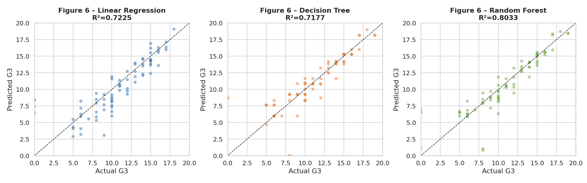
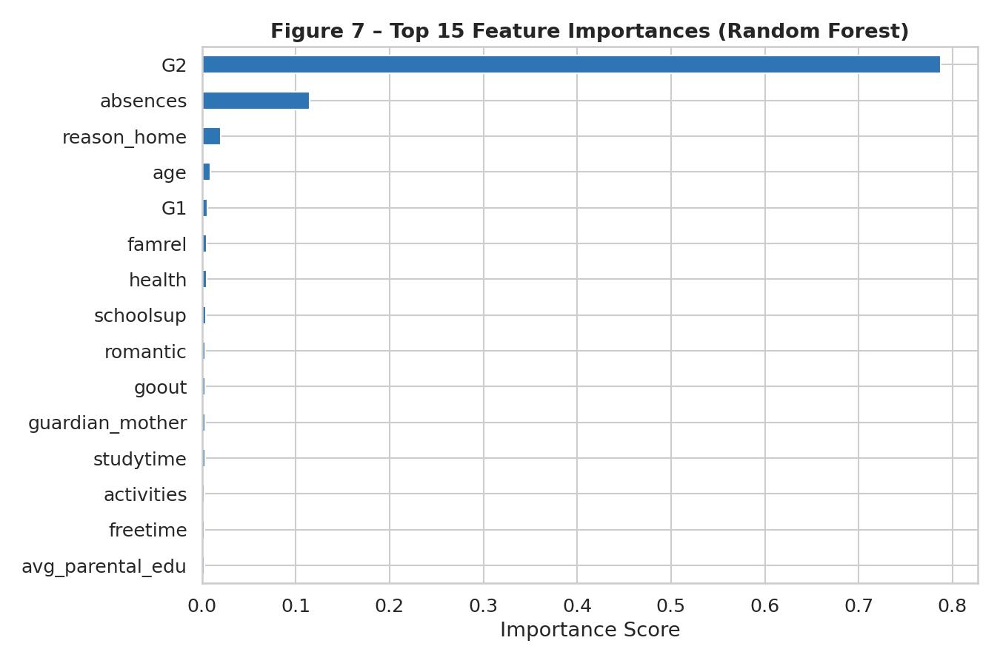
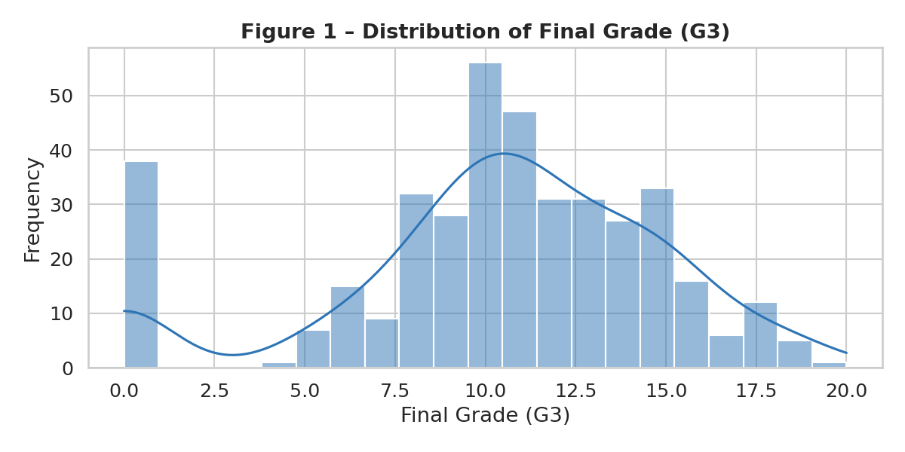
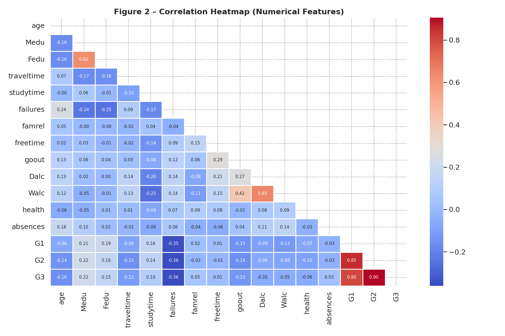
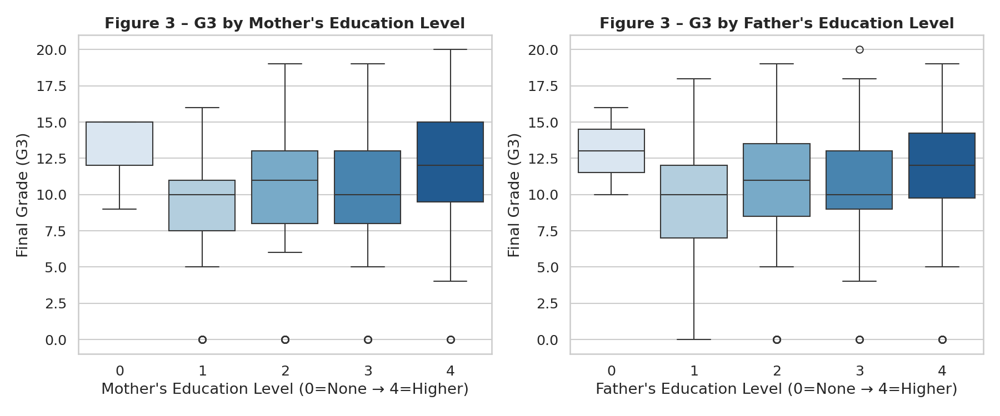
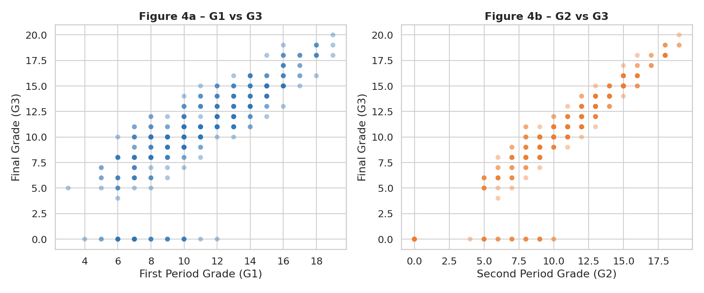
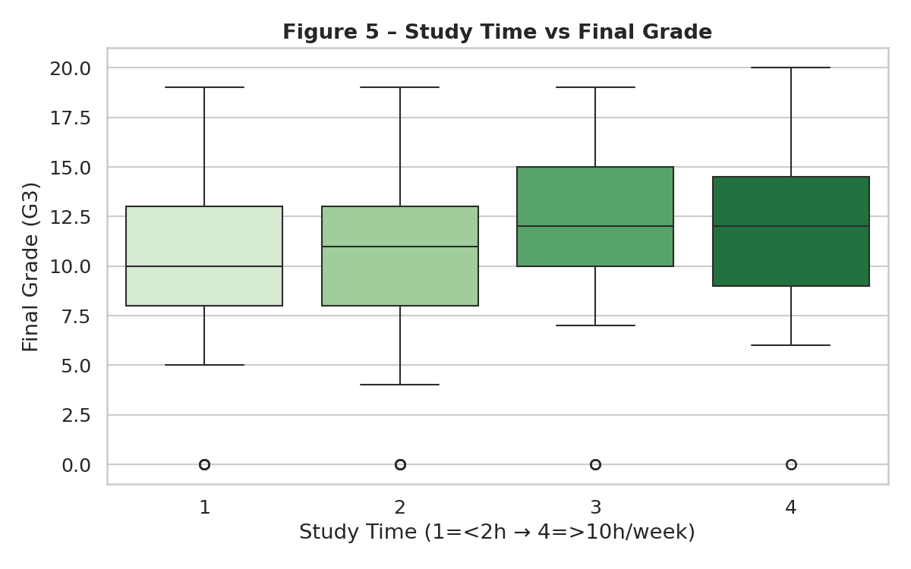
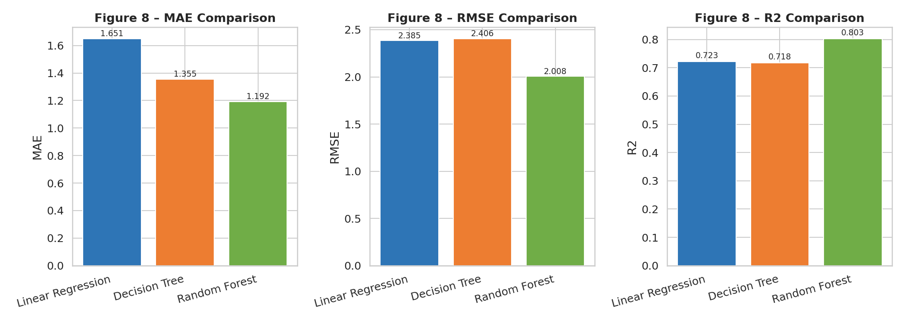

# Student Performance Prediction

Predicting secondary school students' final maths grades with machine learning, following the full **CRISP-DM** process: business understanding, data understanding, data preparation, modelling and evaluation. Three regression models are built and compared: **Linear Regression**, a **Decision Tree** and a **Random Forest**.

Developed for the *DAT7303 – Data Mining and Machine Learning* module, MSc Artificial Intelligence, University of Greater Manchester.

**Tech:** Python · pandas · scikit-learn · matplotlib · seaborn



---

## Business objective

Schools need to identify students at risk of poor results early enough to support them. This project predicts the final grade (G3, on a 0–20 scale) and finds which factors are most strongly linked to it.

**Success criterion:** R² ≥ 0.75 on unseen test data.

---

## Dataset

The [UCI Student Performance dataset](https://archive.ics.uci.edu/dataset/320/student+performance) (mathematics course): **395 students** from two Portuguese secondary schools, with 33 attributes covering demographics, family background, study habits, social life, absences and the three period grades G1, G2 and G3.

> P. Cortez and A. Silva (2008). *Using Data Mining to Predict Secondary School Student Performance.* FUBUTEC 2008, EUROSIS. Licensed under CC BY 4.0.

The data is included in [`data/student-mat.csv`](data/student-mat.csv).

---

## Method

1. **Data understanding:** distributions, correlations and grade progression across the year
2. **Data preparation:** encoding of categorical variables (41 features after encoding), engineered features (average parental education, an alcohol-use risk score) and IQR outlier analysis
3. **Modelling:** 80/20 train–test split (316 / 79 students) and three regression models
4. **Evaluation:** MAE, RMSE, R² on the test set and 5-fold cross-validated R²

---

## Results

| Model | MAE | RMSE | R² (test) | 5-fold CV R² |
|---|---|---|---|---|
| Linear Regression | 1.65 | 2.39 | 0.72 | 0.83 |
| Decision Tree (depth 5) | 1.36 | 2.41 | 0.72 | 0.84 |
| **Random Forest (200 trees)** | **1.19** | **2.01** | **0.80** | **0.90** |

The **Random Forest** is the best model and meets the success criterion: it predicts final grades to within about 1.2 marks out of 20 on average.



**Key findings**

- The second-period grade (**G2**) accounts for about 79% of the Random Forest's feature importance, so recent attainment is by far the strongest predictor of the final grade.
- **Absences** are the next most important factor (about 11%).
- Background factors such as parental education, study time and family relationships have only a small effect once earlier grades are known.

**Limitations**

- Because G1 and G2 dominate, the model mostly extends a student's existing grade trajectory. A genuine *start-of-year* early-warning model would need to be built without G1 and G2, and would be considerably less accurate.
- 38 students have a final grade of 0, which in this dataset largely reflects students who left the course rather than sat the exam. The models predict around 7 for many of them, which inflates the error at the low end.
- The data comes from two schools in one country, so the findings may not generalise.

---

## Running it

```bash
pip install -r requirements.txt
python student_performance.py
```

The script prints each CRISP-DM stage to the console and saves nine charts to `figures/`. The full output from the last run is in [`results.txt`](results.txt).

---

## Figures

| | |
|---|---|
|  |  |
|  |  |
|  |  |

---

## Possible improvements

- Build a separate early-warning model without G1 and G2
- Treat the G3 = 0 cases separately (for example, a classifier for dropping out)
- Tune hyperparameters with GridSearchCV
- Combine the mathematics and Portuguese course datasets

## Author

**Aniqa Arooj**, MSc Artificial Intelligence, University of Greater Manchester
